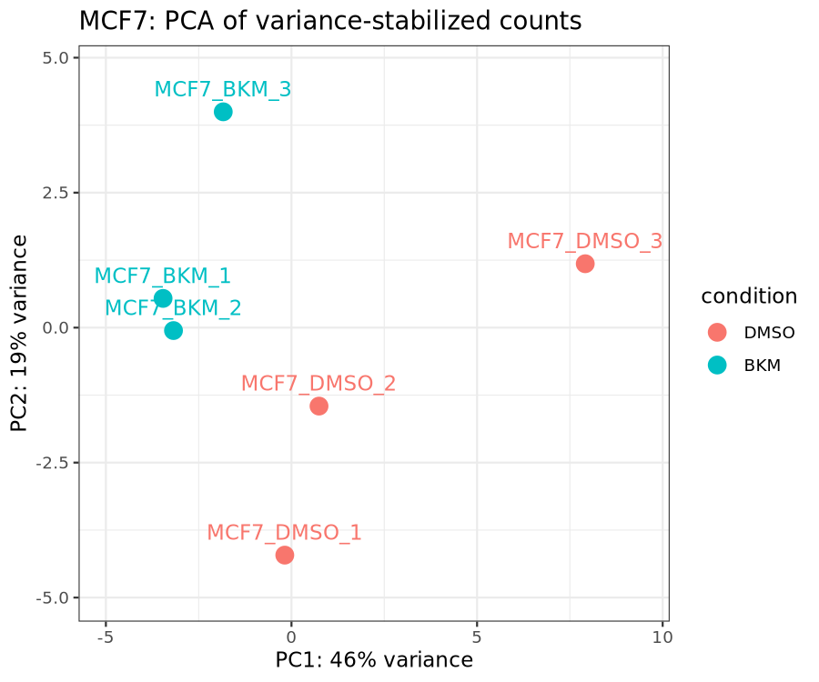
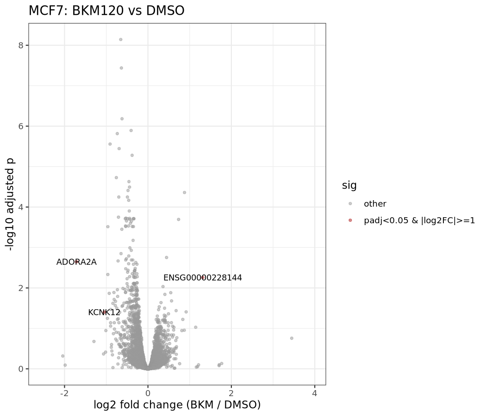
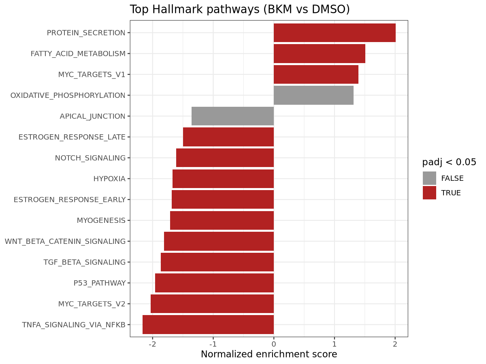

# rnaseq-nextflow

A modular [Nextflow](https://www.nextflow.io/) (DSL2) RNA-seq pipeline, applied to a public dataset: MCF7 breast cancer cells treated with the pan-class I PI3K inhibitor BKM120 (buparlisib) versus DMSO.

The project covers the full path from raw reads to a differential-expression and pathway analysis: checksum-verified download from ENA, QC, trimming, transcript quantification, an aggregated QC report, and a reproducible R analysis. It runs on a laptop (Docker) and on a SLURM cluster (environment modules).

> **Status:** exploratory analysis of one public dataset (n = 3 per group). The pipeline is the main deliverable. The biological results are modest, and the limitations section matters for interpreting them.

## Biological question

How does 3 h of PI3K inhibition change the transcriptome of MCF7 cells? The data are from GEO [GSE186196](https://www.ncbi.nlm.nih.gov/geo/query/acc.cgi?acc=GSE186196) (BioProject PRJNA772940), generated for Hölzen et al., *Theranostics* 2022;12(9):4348-4373 ([doi:10.7150/thno.68299](https://doi.org/10.7150/thno.68299)).

- **Samples used:** 6 human MCF7 samples: BKM120 at 200 nM (3 replicates) and DMSO (3 replicates), 3 h treatment.
- **Not used:** the T0 medium controls, and the MDA-MB-231 and mouse PyB6-313 samples in the same series.
- **Sequencing:** Illumina HiSeq 4000, 2 x 101 bp paired-end, 32-47 million read pairs per sample.
- **Replicates:** the deposit describes them only as "triplicates"; it does not say whether they are independent biological replicates or give batch information.

## Pipeline

```
samplesheet.csv
   |
   +-- FETCH_ENA  ->  FASTQC
   |   (ENA URLs + MD5      |
   |    verification)       +-> FASTP ->  SALMON_QUANT -> MULTIQC
   |                                          ^
   +-- (local FASTQs also supported)    SALMON_INDEX
                                              |
                                  filtered GENCODE transcripts

results -> bin/deseq2_analysis.R (tximport -> DESeq2 -> fgsea)
```

| Step | Tool | Notes |
|---|---|---|
| Download | `bin/fetch_ena.sh` | Resolves FASTQ URLs and MD5s from `metadata/ena_filereport.tsv`; fails the task on a checksum mismatch; tasks retry up to 3 times |
| QC | FastQC | Raw reads |
| Trimming | fastp | Adapter and quality trimming |
| Quantification | Salmon (`--libType A --validateMappings`) | Transcriptome-only index, no decoys |
| Report | MultiQC | Aggregates FastQC, fastp and Salmon outputs |
| Statistics | tximport, DESeq2, fgsea (R) | `~ condition`, reference level DMSO; Hallmark gene sets from MSigDB via msigdbr |

The R analysis runs separately from the Nextflow workflow (see "Run it").

### Versions

| Component | Laptop (Docker) | Cluster (modules) |
|---|---|---|
| Nextflow | 26.10.4 | 25.10.4 |
| FastQC | 0.12.1 | 0.12.1 |
| fastp | 0.23.4 | 0.23.2 |
| Salmon | 1.10.3 | 1.10.3 |
| MultiQC | 1.25.1 | 1.27 |
| R | 4.5.3 (conda, see `environment.yml`) | not used |
| Reference | GENCODE v50 | GENCODE v50 |

The full dataset was processed with the **cluster (modules) versions**. `FETCH_ENA` has no container and uses the node's `curl`, `awk` and `md5sum`.

## Repository layout

```
main.nf, nextflow.config       workflow and profiles
modules/                       one file per process
conf/                          docker, singularity, slurm, modules, test profiles
bin/                           fetch_ena.sh, prepare_reference.sh, make_tx2gene.sh, deseq2_analysis.R
assets/                        samplesheets (test, MCF7 full, MCF7 batch 1)
metadata/                      ENA run table, excluded-gene list
test_data/                     tiny FASTQ subsets for the test profile
docs/results/                  final figures, tables and MultiQC report
environment.yml                R environment
run_hummingbird.sbatch         SLURM launcher
```

## Run it

### 1. Reference

Download the GENCODE v50 human **transcript sequences** (`gencode.v50.transcripts.fa.gz`) and the **comprehensive annotation, CHR** (`gencode.v50.annotation.gtf.gz`) from [GENCODE](https://www.gencodegenes.org/human/) into `reference/`, then:

```bash
bin/prepare_reference.sh reference/gencode.v50.transcripts.fa.gz reference/gencode.v50.annotation.gtf.gz reference
```

This keeps only transcripts present in the chromosome-only annotation (see "Limitations") and writes `reference/transcripts_chr.fa.gz` and `reference/tx2gene_chr.tsv`.

### 2. Laptop test (Docker)

```bash
nextflow run . -profile test,docker --transcriptome reference/transcripts_chr.fa.gz
```

The test profile runs two samples using small FASTQ subsets in `test_data/` (the first 20,000 read pairs of two MCF7 samples).

### 3. Full run on a SLURM cluster

```bash
TRANSCRIPTOME=reference/transcripts_chr.fa.gz NF_PROFILE=modules \
  sbatch run_hummingbird.sbatch assets/samplesheet_mcf7.csv results_mcf7_chr
```

Written for the UCSC Hummingbird cluster; adjust the partition in `conf/modules.config` and `run_hummingbird.sbatch` for other clusters. A `slurm,singularity` profile also exists, but it did not work on Hummingbird because the compute nodes lacked `libfuse3` and `unsquashfs`, so the `modules` profile was used instead. The full MCF7 run (6 samples, about 30 GB of FASTQ) took about 1.5 hours, almost all of it downloading from ENA.

### 4. Differential expression and pathways

```bash
conda env create -f environment.yml          # R 4.5.3, tximport, DESeq2, fgsea, msigdbr
Rscript bin/deseq2_analysis.R assets/samplesheet_mcf7.csv results_mcf7_chr/salmon \
  reference/tx2gene_chr.tsv analysis_mcf7_chr
```

Genes listed in `metadata/excluded_genes.txt` are removed before testing (see "Limitations"). Re-running the script gives identical results (fgsea uses a fixed seed).

## Results

All numbers are from the final run: six samples, filtered reference, 15 excluded genes. Figures and tables are in [`docs/results/`](docs/results/).

### Quality control

- Salmon mapping rates were 89.5-91.0% in all six samples, with no systematic difference between groups.
- Read counts were in the tens of millions per sample, consistent with the ENA metadata.

### Differential expression (BKM120 vs DMSO)

- 18,137 genes were tested. At adjusted p < 0.05, **18 were higher and 199 lower** with BKM120.
- Effects are small. No individual gene is strong enough to name as a result (see below).



The BKM120 samples cluster on one side of PC1 (47% of variance), but `MCF7_DMSO_3` is an outlier and the spread between replicates is substantial.



### Pathways (fgsea, MSigDB Hallmark)



- 13 Hallmark sets are significant at padj < 0.05 (full table: [`docs/results/fgsea_hallmark.csv`](docs/results/fgsea_hallmark.csv)). **Lower** with BKM120: TNF-alpha signaling via NF-kB (NES -2.17, padj 9e-9), the p53 pathway (-1.96), MYC targets V2 (-2.03), TGF-beta signaling, estrogen response (early and late), hypoxia, myogenesis, Wnt/beta-catenin and Notch signaling. **Higher**: protein secretion (+2.01), fatty acid metabolism, and MYC targets V1 (+1.39, padj 0.025). MYC targets V1 and V2 move in opposite directions, so there is no single MYC result. Oxidative phosphorylation (padj 0.050) and apical junction (0.060) just miss the cutoff.
- **Robustness:** all 13 significant sets keep their direction when `DMSO_3` is removed (filtered index, five samples), and 11 of the 13 remain significant at padj < 0.05. The two that do not are fatty acid metabolism (padj 0.011 to 0.20) and Wnt/beta-catenin signaling (0.007 to 0.060, just above the cutoff), so those two should be treated as less certain. The directions were also the same on the first (unfiltered) index.
- The NF-kB set label is misleading here: its leading edge is dominated by immediate-early genes (for example `ZFP36`, `EGR1`, `JUNB`, `JUN`, `FOS`), while `TNFAIP3` itself is unchanged. I read this as a lower immediate-early response, not evidence about NF-kB signaling.
- **PI3K/AKT/mTOR** trends lower but is **not significant** (NES -1.44, padj 0.074; padj 0.156 without `DMSO_3`). Its padj ranged from 0.04 to 0.16 across the analysis variants I ran, so the signal sits near the threshold and depends on analysis choices.
- Hallmark sets overlap and share genes, so the pathways are not independent confirmations of one another.

### Genes of interest

Transcript levels of *PIK3CA*, *AKT1*, *MTOR*, *PTEN*, *TP53*, *KRAS*, *EGFR* and *MYC* were not significantly changed by 3 h BKM120 (all padj > 0.6, |log2FC| < 0.13). PI3K inhibition acts on protein activity, so this is expected. With n = 3 per group, the design would miss changes smaller than roughly 0.2-0.3 log2 (estimated from the standard errors), so this is an absence of evidence and not a demonstration of no effect.

### Comparison with the source paper

The paper's RNA-seq analysis reports only protease (degradome) genes, using hg19 and Kallisto, so there is no whole-transcriptome result or pathway analysis to compare with. A direction check of 16 genes that the paper reports as changed in all three of its cell lines showed 9 in the same direction and 6 in the opposite direction in this analysis, with none significant (one gene appeared twice with opposite signs). This is inconclusive: the methods and power differ.

## Limitations

- **Small, single experiment.** n = 3 per group, one cell line, no independent validation.
- **`DMSO_3` outlier.** It is the most distant sample on the PCA, with normal QC (91.0% mapped, 37.7 M reads). The three genes highlighted on the volcano plot (*ADORA2A*, *KCNK12* and an unnamed locus, ENSG00000228144) are each carried by one or two DMSO samples, and the first two lose significance without `DMSO_3`. The six-sample analysis is the primary one, and the five-sample analysis is reported as a sensitivity check ([`docs/results/sensitivity_*`](docs/results/)). No batch or date information is available to explain it.
- **Unknown replicate design.** The deposit calls the samples "triplicates" without saying whether they are independent biological replicates.
- **Duplicate and alternate-sequence loci.** The GENCODE transcript FASTA contains copies of genes on alternate or patch sequences that are absent from the chromosome-only annotation. Near-identical copies compete for reads, so in the first index 768 expressed genes (about 4% of those tested) had read counts shared with such a copy (for example *PTEN*, whose reads were split between two entries). I rebuilt the index from only the transcripts present in the chromosome annotation (`bin/prepare_reference.sh`), which fixed *PTEN* and improved the PCA separation, but paralogs and annotated artifact copies can still share reads.
- **Exclusion list built partly after seeing results.** `metadata/excluded_genes.txt` has 15 genes: 12 chosen because they had zero counts across a whole group, and 3 (*MAGED4*, *MAGED4B*, *SMIM11*) added after they appeared on the volcano plot and a check showed reads moving between near-identical copies. It is a list of known problems and is not exhaustive.
- **No decoy-aware Salmon index.** I used a transcriptome-only index to fit laptop memory. Salmon also removes sequence-duplicate transcripts by default (15,842 on the first, unfiltered index; not recorded for the filtered one).
- **Tool versions differ** between the laptop and cluster profiles (see the table above). The full dataset was processed with the cluster versions.
- **PI3K/AKT/mTOR enrichment is not established.** See the pathway section.

## Data and reference

- Data: GEO GSE186196 / SRA PRJNA772940 (run accessions in `assets/samplesheet_mcf7.csv`, checksums in `metadata/ena_filereport.tsv`).
- Reference: GENCODE human release 50.
- Paper: Hölzen L, et al. *Theranostics* 2022;12(9):4348-4373.

## License

MIT (see `LICENSE`).